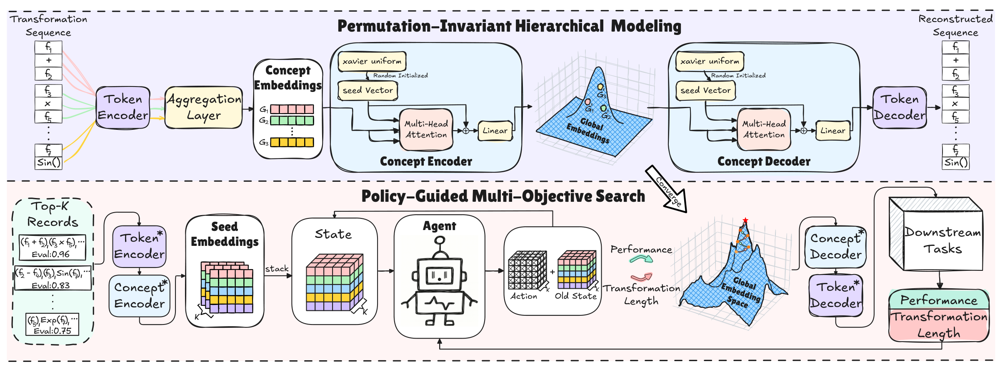
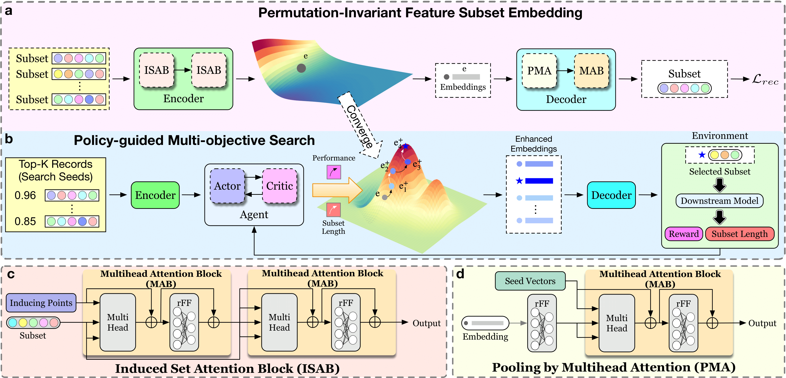

# 📝 Publications 

CIKM 2026

[Hierarchical and Permutation-Invariant Feature Transformation Learning via Policy-Guided Embedding Search](https://dl.acm.org/doi/abs/10.1145/3799682.3840882) \
**Rui Liu**, Tao Zhe, Yanyong Huang, Sankha Narayan Guria, Xiao Luo, Wei Fan, Yanjie Fu, Dongjie Wang

- **Academic Impact**: In this work, we address three critical challenges in feature transformation by introducing a permutation-invariant hierarchical modeling module and a policy-guided multi-objective reinforcement learning search strategy, providing an effective and robust solution.

KDD 2025

[Continuous Optimization for Feature Selection with Permutation-Invariant Embedding and Policy-Guided Search](https://doi.org/10.1145/3711896.3736891) \
**Rui Liu**, Rui Xie, Zijun Yao, Yanjie Fu, Dongjie Wang

- **Academic Impact**: In this work, we address two critical challenges in feature selection by introducing a permutation-invariant encoder-decoder and a policy-guided reinforcement learning search strategy, providing a robust and generalizable solution.

